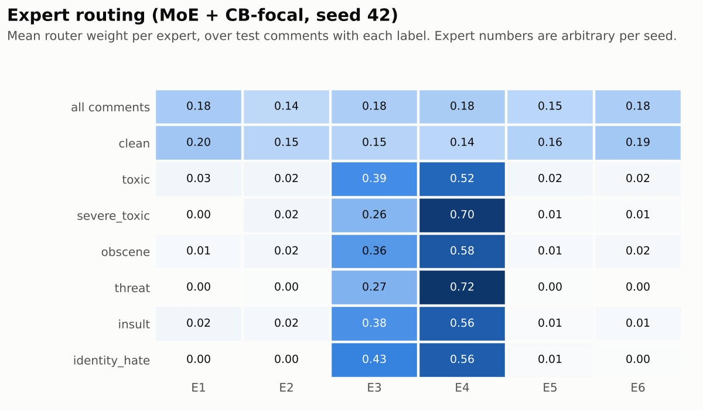
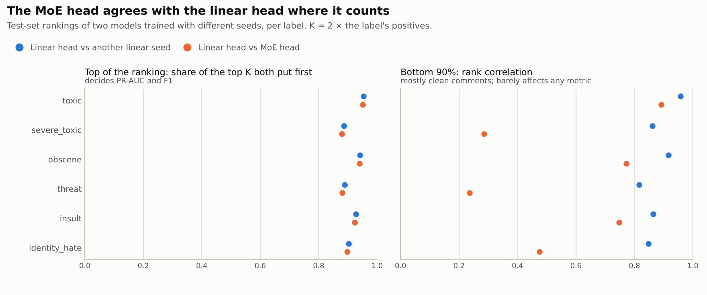
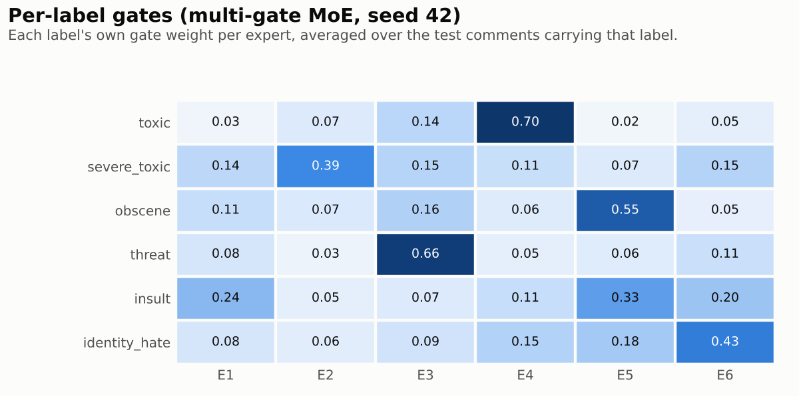
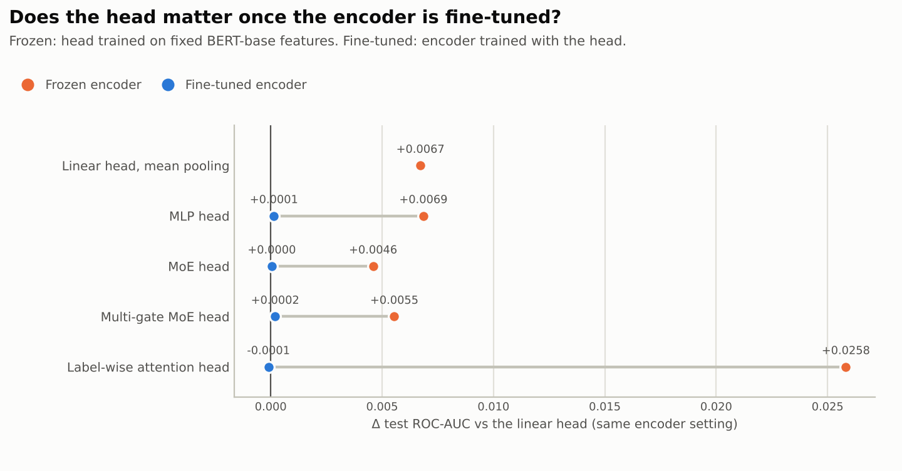
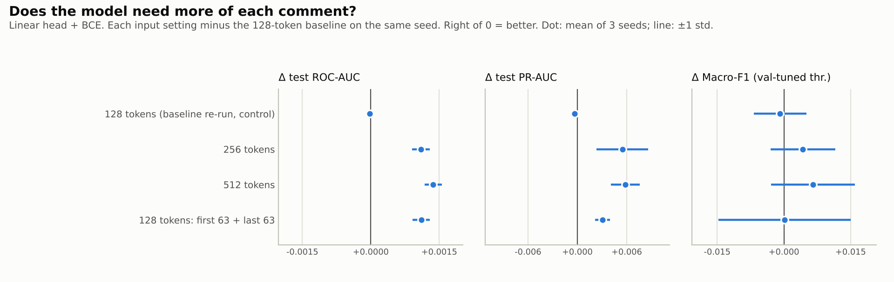

# Why the MoE head didn't help

The 24-run study ([README](../README.md#results)) found that a Mixture-of-Experts head on BERT
ties with a plain linear head. This page works out why from the saved runs. It then tests that
explanation with 18 more runs: four new heads × 3 seeds, including two built specifically to get
around the MoE's problem, plus six heads trained on a frozen encoder. Section 7 tests where the
diagnosis did find headroom, the input length (9 more runs).

Every number here comes from [`scripts/diagnose.py`](../scripts/diagnose.py) or
[`scripts/make_report.py`](../scripts/make_report.py). Their full output is in
[`results/diagnosis.md`](../results/diagnosis.md) and [`results/summary.md`](../results/summary.md).
Unless a section says otherwise, comparisons are BERT-base with plain BCE, paired by seed with
the linear-head baseline `bert_bce`: same loss, same seeds, same data.

## The short answer

1. **The router could only learn "toxic vs clean".** In `train.csv`, 93–100% of comments with a
   rare label are also `toxic`. One routing decision per comment therefore cannot separate the
   labels. In all 12 MoE runs, every label's positives go mostly to the same two experts.
2. **Forcing label-specific experts does not help either.** The multi-gate MoE gives each label
   its own gate, and the labels do end up on different experts: for the same comment, the six
   label gates differ by 0.87 on a 0–1 scale. The scores still don't move (ROC-AUC +0.0002 ±
   0.0001, PR-AUC −0.003 ± 0.002).
3. **Once BERT is fine-tuned, the head hardly matters.** On a frozen encoder, the five heads span
   0.026 ROC-AUC, and label-wise attention is far ahead. Fine-tuned, all five are within 0.0002 of
   the linear head.
4. **The MoE head's only measurable effect is a small cost, and the routing does not cause it.**
   It loses 0.014 PR-AUC on the rare labels. An MLP head of the same size, with no routing at
   all, loses the same (0.017). Load balancing makes no difference either: without it, the router
   puts almost every comment on one expert, and the scores are unchanged.

Averaging three seeds of the plain linear head gains more (+0.008 PR-AUC) than any head
achieved. The remaining errors are concentrated in long comments and in what is probably label
noise ([section 6](#6-where-the-remaining-errors-are)). Letting BERT read 512 tokens instead of
128 is the first change that helps: +0.0014 ROC-AUC, more than any head, loss or seed ensemble
([section 7](#7-longer-inputs-the-first-change-that-helps)).

## 1. What the router learned

How often each label comes with `toxic` in `train.csv`:

| Label | Positives | Also `toxic` |
|---|---:|---:|
| `severe_toxic` | 1,595 | 100.0% |
| `obscene` | 8,449 | 93.8% |
| `threat` | 478 | 93.9% |
| `insult` | 7,877 | 93.2% |
| `identity_hate` | 1,405 | 92.7% |

Total-variation distance between mean router weights (0 = same experts, 1 = disjoint):

| MoE setting | Distance between the six labels | Toxic vs clean | Weight that each label's positives put on the top-2 "toxic" experts (lowest label) | Same, for clean comments (uniform = 33%) |
|---|---:|---:|---:|---:|
| BCE | 0.12 ± 0.05 | 0.68 ± 0.02 | 93% | 29% |
| Weighted BCE | 0.07 ± 0.07 | 0.76 ± 0.04 | 98% | 27% |
| Focal | 0.21 ± 0.03 | 0.47 ± 0.03 | 67% | 28% |
| Class-balanced focal | 0.14 ± 0.03 | 0.55 ± 0.07 | 85% | 31% |

Toxic and clean comments are routed very differently (0.47–0.76). The six labels are routed
almost the same way as each other (0.07–0.21). The load-balancing loss sits at 1.01–1.03 (1.0 =
perfectly balanced): balance is met by spreading clean comments over the other four experts.

<picture>
  <source media="(prefers-color-scheme: dark)" srcset="figures/expert_routing_dark.png">
  
</picture>

**The router is not making many mistakes.** About 38% of all test comments put most of their
weight on the two "toxic" experts. That is far more than the 10% that are toxic, so the router
works as a generous "could be toxic" switch. Of the ~6,000 comments per seed that the linear
head scores 0.9 or higher for `toxic`, the router sends **none** elsewhere. With the labels: the
BCE-trained MoE sends at most 1% of any label's positives mostly to the "clean" experts (up to 3%
with class-balanced focal loss). Almost all of those are missed, but they are too few to move
the averages.

## 2. Almost the same ranking where it counts

For each label, take the *K* highest-scored test comments (K = twice the label's positives).
That is where PR-AUC and F1 are decided. Compare two models trained with different seeds:

<picture>
  <source media="(prefers-color-scheme: dark)" srcset="figures/diagnosis_agreement_dark.png">
  
</picture>

| Label | Top-K overlap: linear vs another linear seed | Top-K overlap: linear vs MoE | Bottom-90% rank correlation: linear vs linear | Bottom-90%: linear vs MoE |
|---|---:|---:|---:|---:|
| `toxic` | 0.953 | 0.951 | 0.957 | 0.892 |
| `severe_toxic` | 0.886 | 0.879 | 0.861 | 0.286 |
| `obscene` | 0.941 | 0.939 | 0.916 | 0.773 |
| `threat` | 0.889 | 0.880 | 0.816 | 0.236 |
| `insult` | 0.927 | 0.923 | 0.864 | 0.747 |
| `identity_hate` | 0.901 | 0.897 | 0.848 | 0.476 |

At the top, the MoE head is about as interchangeable with the linear head as one linear seed is
with another. My first look at whole-ranking correlations (about 0.5 between the two heads for
`severe_toxic` and `threat`) suggested the MoE had learned something different. Splitting the
ranking shows that most of the disagreement is in the bottom 90%, among comments that are almost
all clean. There, each "clean" expert adds its own offset to the rare-label scores: the chosen
expert explains 21–34% of the variance of those logits, against 5–8% for the linear head grouped
the same way.

"About as interchangeable" is not "identical". On `severe_toxic` and `threat` the MoE's PR-AUC is
0.02 lower. A bootstrap over the test comments puts that outside test-sampling noise: −0.022
[−0.034, −0.011] and −0.026 [−0.047, −0.004]. Section 4 shows where that cost comes from.

## 3. The F1 differences are mostly threshold noise

F1 uses one threshold per label, tuned on the validation split. With only 46 `threat` and 142
`identity_hate` comments in validation, those thresholds are noisy. Tuning them on test itself
("oracle" thresholds, from the saved precision-recall curves) is not a fair score, but it
removes that noise. Paired difference from the baseline, mean ± std over 3 seeds:

| Setting | Δ macro-F1, val thresholds | Δ macro-F1, oracle thresholds | Δ rare-label F1, val thresholds | Δ rare-label F1, oracle thresholds |
|---|---:|---:|---:|---:|
| Linear, weighted BCE | +0.005 ± 0.012 | +0.001 ± 0.002 | +0.013 ± 0.022 | +0.007 ± 0.005 |
| Linear, focal | −0.003 ± 0.016 | −0.002 ± 0.002 | −0.003 ± 0.023 | −0.004 ± 0.005 |
| Linear, class-balanced focal | −0.001 ± 0.018 | −0.001 ± 0.004 | +0.001 ± 0.026 | +0.001 ± 0.008 |
| MoE, BCE | +0.002 ± 0.013 | −0.002 ± 0.003 | +0.001 ± 0.014 | −0.005 ± 0.006 |
| MoE, weighted BCE | +0.007 ± 0.012 | +0.001 ± 0.006 | +0.017 ± 0.015 | +0.006 ± 0.012 |
| MoE, focal | +0.001 ± 0.011 | −0.002 ± 0.005 | +0.000 ± 0.013 | −0.005 ± 0.010 |
| MoE, class-balanced focal | +0.003 ± 0.013 | −0.001 ± 0.002 | +0.007 ± 0.012 | −0.002 ± 0.005 |

Transferring thresholds from validation to test costs 0.02 macro-F1 on average (0.04 on
`toxic`). Without that noise, the seed-to-seed spread of the macro-F1 differences shrinks about
4× (2–8×). Three of the four MoE heads then come out slightly behind the baseline, and the
fourth (weighted BCE) is within noise of it. The one consistent sign is weighted BCE on the
linear head: +0.007 ± 0.005 rare-label F1. That is about 1.4 standard deviations over 3 seeds,
so it is a hint, not a result.

## 4. Testing the explanation

Four new heads, each trained with 3 seeds ([`configs/heads.yaml`](../configs/heads.yaml)), and
the same heads on a frozen encoder ([`configs/probes.yaml`](../configs/probes.yaml), 1 seed):

* **Multi-gate MoE** ([Ma et al., 2018](https://dl.acm.org/doi/10.1145/3219819.3220007)): shared
  experts, one softmax gate per label. It moves the routing decision from the comment to the
  label, so `threat` and `obscene` can use different experts for the same comment.
* **Label-wise attention** ([Vu et al., 2020](https://arxiv.org/abs/2007.06351)): each label pools
  the token vectors with its own attention instead of sharing the [CLS] vector. It also shows
  which words drove each label.
* Two controls: an **MLP head** with the MoE head's parameter count and no routing, and the
  **MoE head without load balancing**.

| Question | Run | Result (paired vs linear head, 3 seeds) | Answer |
|---|---|---|---|
| Can the labels use different experts if each has its own gate? | `mmoe_bce` | They do: the six labels' routing is 0.47 apart (MoE router: 0.13), and the gates of one comment differ by 0.87. Scores: ROC-AUC +0.0002 ± 0.0001, PR-AUC −0.003 ± 0.002. | The specialisation happens and does not help. |
| Does each label need its own view of the words? | `labelattn_bce` | ROC-AUC −0.0001 ± 0.0002, PR-AUC +0.001 ± 0.001, rare-label PR-AUC +0.002 ± 0.001, with a sixth of the MoE head's parameters. | Not once BERT is fine-tuned: the [CLS] vector already carries it. |
| Is the head's size what matters? | `mlp_bce` | ROC-AUC +0.0001 ± 0.0002, PR-AUC −0.008 ± 0.003, rare-label PR-AUC −0.017 ± 0.006. The MoE: +0.0000 ± 0.0001, −0.008 ± 0.001, −0.014 ± 0.002. | The MoE behaves like an MLP of its size. Its rare-label loss comes from the extra hidden layer, not the routing. |
| Does load balancing hurt? | `moe_bce_noaux` | The router collapses: one expert takes 96–100% of comments in every seed. ROC-AUC +0.0000 ± 0.0001, PR-AUC −0.007 ± 0.005. | No. It makes no difference. |
| Does the head matter once the encoder is fine-tuned? | frozen-encoder probes | Frozen: label attention 0.980 ROC-AUC vs 0.955 for the linear head (+0.026, PR-AUC 0.638 vs 0.492); the other heads +0.005 to +0.007. Fine-tuned: all within ±0.0002. | No. Fine-tuning absorbs what the head could add. |

<picture>
  <source media="(prefers-color-scheme: dark)" srcset="figures/mmoe_gates_dark.png">
  
</picture>

<picture>
  <source media="(prefers-color-scheme: dark)" srcset="figures/probes_dark.png">
  
</picture>

**My expectations, written down before the runs, and how they held up.** I expected every head to
tie with the linear head after fine-tuning, with clear differences only in the frozen probes.
That held. I expected the label-attention head to be the most likely to help on the rare labels.
It is the best of the five fine-tuned heads, and the only one that does not lose rare-label
PR-AUC, but the gain (+0.002 ± 0.001, about 1.5 standard deviations over 3 seeds) is too small to
call. With a fine-tuned encoder, this task leaves no room for a better head. The next gains have
to come from the input, the encoder or the data. Section 7 tests the first of these.

## 5. What the test labels add

* **Telling kinds of toxicity apart.** Among the 6,090 toxic test comments, every head is within
  0.005 of the linear head on every sub-label's ROC-AUC. `obscene` (0.877) and `insult` (0.853)
  are the hard ones for all of them. This is the job that label-specialised experts were supposed to do.
* **Ensembles.** Averaging the 3 seeds of the linear head gains +0.0004 ROC-AUC and +0.008 PR-AUC,
  more than any head change. A linear head paired with an MoE head is no better than two linear
  heads (PR-AUC 0.690 vs 0.694). The MoE learned nothing the linear head was missing.

## 6. Where the remaining errors are

* **Validation vs test.** All 36 fine-tuned runs score 0.0061 lower ROC-AUC on test than on
  validation (std 0.0003). The gap is in `toxic` (0.014), `obscene` (0.011) and `insult` (0.009),
  not in the rare labels.
* **Long comments.** 19% of test comments are longer than the 128-token input window, so the
  model never sees their end. On them, ROC-AUC drops for the frequent labels: `toxic` 0.957 vs
  0.974 on short comments, `obscene` 0.966 vs 0.982, `insult` 0.968 vs 0.981. The rare labels
  are barely affected. Section 7 tests longer inputs.
* **Probable label noise.** Averaged over all 36 fine-tuned runs, 730 test comments labelled
  clean get p(`toxic`) ≥ 0.9, while only 34 of the 6,090 comments labelled toxic get ≤ 0.05.
* **For scale:** this single BERT-base scores 0.9855 (0.9868 with 512-token inputs, section 7).
  [Detoxify](https://huggingface.co/unitary/toxic-bert)'s BERT-base model reports 0.98636, and the
  top Kaggle leaderboard score was 0.98856.

## 7. Longer inputs: the first change that helps

Section 6 points at the input rather than the head. [`configs/length.yaml`](../configs/length.yaml)
therefore keeps the linear head and BCE and changes only what BERT reads. With [CLS] and [SEP], a
128-token input holds the first 126 tokens of a comment. The alternatives are 256 tokens, 512
tokens (BERT's maximum), and 128 tokens made of the first 63 and the last 63 tokens ("head +
tail", [Sun et al., 2019](https://arxiv.org/abs/1905.05583)). Each has 3 seeds, paired with the
baseline's:

| Input | Time / run (A100) | Test ROC-AUC | Δ ROC-AUC | Δ PR-AUC |
|---|---:|---:|---:|---:|
| 128 tokens: first 126 (baseline) | 7.5 min | 0.9855 | – | – |
| 256 tokens: first 254 | 7.7 min | 0.9866 | +0.0011 ± 0.0002 | +0.005 ± 0.003 |
| 512 tokens: first 510 | 8.2 min | 0.9868 | +0.0014 ± 0.0002 | +0.006 ± 0.002 |
| 128 tokens: first 63 + last 63 | 7.5 min | 0.9866 | +0.0011 ± 0.0002 | +0.003 ± 0.001 |

<picture>
  <source media="(prefers-color-scheme: dark)" srcset="figures/length_dark.png">
  
</picture>

* **Every seed improves.** All nine paired ROC-AUC differences lie between +0.0009 and +0.0016,
  and validation ROC-AUC moves the same way (+0.0009, +0.0015 and +0.0013 for 256 tokens, 512
  tokens and head + tail). For comparison, no head or loss in this repository raised ROC-AUC by
  more than 0.0003, and averaging three seeds of the baseline raised it by 0.0004 (section 5).
* **Most of the gain is cheap.** 256 tokens gets about 80% of the 512-token gain. Head + tail
  gets as much ROC-AUC as 256 tokens while reading no more than the baseline. Comments of similar
  length are batched together and padded only to the longest in their batch, so 512 tokens costs
  under 10% more time than 128.
* **Every label gains, `insult` the most.** Δ ROC-AUC at 512 tokens: `insult` +0.0021, `toxic`
  +0.0015, `obscene` +0.0015, `severe_toxic` +0.0015 (noisy: ± 0.0009), `identity_hate` +0.0012,
  `threat` +0.0004.
* **Head + tail helps the frequent labels as much as 512 tokens, the rare ones less.** On
  `toxic`, `obscene` and `insult` it gains as much PR-AUC as 512 tokens (+0.0070, +0.0056 and
  +0.0068, vs +0.0049, +0.0050 and +0.0085). Averaged over the three rare labels it gains nothing
  (+0.000 ± 0.001, vs +0.006 ± 0.004 with 512 tokens), and `identity_hate` ROC-AUC does not move.
  Rare-label PR-AUC is noisy, though; the per-label tables are in the
  [README](../README.md#results).
* **For scale:** at 0.9868, one BERT-base reading 512 tokens is slightly above the 0.98636 that
  Detoxify reports for its BERT-base model, and 0.0018 below the top Kaggle score.

**My expectations, written on this page before the runs (see its git history), and how they held
up:**

| Expectation | Result |
|---|---|
| 512 tokens raises `toxic`, `obscene` and `insult` ROC-AUC on long comments, without closing the gap to short comments. | The three labels gain +0.0015, +0.0015 and +0.0021 overall. The split into short and long comments is still to come. |
| That adds only a few ten-thousandths to the overall mean, because 81% of comments are unaffected. | Wrong: +0.0014, several times more. |
| 256 tokens gets most of that gain. | Held: about 80%. |
| Head + tail helps only if the end of a long comment matters more than its middle. | It gained as much ROC-AUC as 256 tokens, so the end does matter more. |
| The rare labels do not change. | Wrong for `identity_hate` (+0.0012 ± 0.0002 at 512 tokens) and probably for `severe_toxic` (+0.0012 to +0.0016 in all three settings, each ± 0.0009–0.0012). Right for `threat` (+0.0002 to +0.0004). In hindsight, `severe_toxic` has the most long comments of any label: 23% of its positives, against 8% for `toxic`. |

**A caveat: the software version.** The baseline was trained with `transformers` 5.17 and these
runs with 5.18, on the same GPU type with the same PyTorch version and seeds. Two checks are
queued to rule the update out as the cause. `configs/length.yaml` now also re-trains the
128-token baseline in the new environment (`bert_bce_len128`), and `scripts/diagnose.py` compares
the cached token ids of all runs, which shows whether tokenization changed. The split into short
and long comments is a third check: on comments that fit in 128 tokens, every setting is given
exactly the same input, so a gain that comes from reading more should come mostly from the long
comments. Until these are in, read the gains as very likely but not final.

## What I'd try next

* **Finish the input-length checks** (section 7): the same-environment control and the split
  into short and long comments.
* **A look at the 730 confident disagreements** (`diagnose.py --show-examples`), to measure how
  much of the remaining error is label noise.
* **Ensembles of 512-token models.** At 128 tokens, averaging three seeds added +0.008 PR-AUC.
* **MoE where it is usually used:** experts inside the encoder's feed-forward layers, routed per
  token and initialised from BERT's own weights ("sparse upcycling",
  [Komatsuzaki et al., 2023](https://arxiv.org/abs/2212.05055)).
